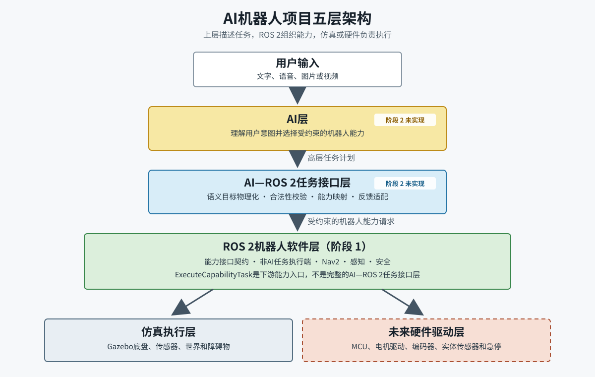

# PU1-01 项目总体架构

> 所属PU：PU1 项目总体架构与工程资源<br>
> 教材单元：1/5<br>
> 版本：v1.1<br>
> 适用项目：`/home/ubuntu/ai_robot_ws`<br>
> 适用环境：Ubuntu 22.04、ROS 2 Humble<br>
> 学习边界：只学习架构和接口关系，不实现AI Agent，不执行实体机器人操作。

[TOC]

## 1. 本单元要解决什么问题

学习一个机器人项目时，首先需要知道系统由哪些层组成、每层负责什么，以及一条任务如何从上层传递到底盘和传感器。

完成本单元后，您应能解释：

1. AI层、任务接口层、ROS 2功能层、仿真执行层和未来硬件驱动层的职责；
2. 当前项目已经实现了哪些层，哪些层尚未开发；
3. 底盘、传感器、建图、定位、导航和安全模块如何协作；
4. 上层结构化任务如何进入机器人系统并返回结果；
5. 为什么AI不能直接控制电机或发布底盘速度。

[](../../assets/PU1/PU1-01_项目总体架构.svg)

图1：AI机器人项目五层架构。当前学习对象集中在任务接口层、ROS 2功能层和仿真执行层。图片较小时可点击查看原图。

## 2. 五层总体架构

项目采用以下分层：

```text
用户或测试程序
        |
        v
AI层（阶段 2，当前未实现）
        |
        | 受约束的结构化任务
        v
任务接口层
        |
        | Action、Service、受控Topic
        v
ROS 2功能层
        |
        +-------------------------+
        |                         |
        v                         v
仿真执行层                 未来硬件驱动层
Gazebo模型与插件            MCU、驱动器和实体传感器
```

分层的目的不是把系统画得复杂，而是限制职责：

- 上层描述“做什么”；
- ROS 2功能层决定“怎样安全完成”；
- 仿真或硬件层负责“实际执行和产生数据”。

### 2.1 AI层

AI层属于阶段 2，当前没有实现，也不会在ROS 2学习阶段启动。

未来职责包括：

- 理解文字、语音、图片或视频；
- 识别用户意图；
- 形成高层任务计划；
- 选择经过批准的机器人能力；
- 根据结构化结果向用户解释任务状态。

AI层禁止：

- 直接控制电机或驱动器；
- 直接发布`/cmd_vel`；
- 绕过Nav2、任务管理器或安全守卫；
- 自行运行任意Shell命令；
- 未经确认就把语义地点转换为物理坐标。

核心原则是：AI只能请求受约束的机器人能力，不能接管底盘实时控制。

### 2.2 任务接口层

任务接口层是上层调用者与ROS 2机器人之间的契约边界。

当前项目的结构化任务接口是：

```text
src/ai_robot_interfaces/action/ExecuteCapabilityTask.action
```

它包含：

- 任务ID；
- 能力名称；
- 目标位姿；
- 超时时间；
- 是否需要雷达和图像；
- 执行阶段反馈；
- 成功、失败、取消、超时和安全触发等结果。

当前执行节点是：

```text
src/ai_robot_sim/ai_robot_sim/capability_task_manager.py
```

任务管理器负责校验任务、调用Nav2、检查传感器和安全状态，并返回结构化结果。它不会理解自然语言，也不会调用大模型，因此它属于阶段 1的非AI机器人能力层。

### 2.3 ROS 2功能层

ROS 2功能层是当前机器人系统的主体。

| 模块 | 主要职责 | 当前实现 |
|---|---|---|
| 机器人模型 | 描述车体、车轮、关节和传感器安装关系 | `ai_robot_description` |
| 底盘控制 | 接收安全速度，产生运动和里程计 | Gazebo差速插件 |
| 安全监督 | 限速、命令超时停车和传感器新鲜度检查 | `cmd_vel_guard.py` |
| 传感器 | 发布雷达、相机、IMU和轮状态 | Gazebo传感器插件 |
| 状态估计 | 融合里程计和IMU | `robot_localization` EKF |
| 建图 | 根据雷达、里程计和TF建立地图 | `slam_toolbox` |
| 定位 | 在已有地图中估计机器人位置 | AMCL |
| 导航 | 规划、控制、避障、恢复和取消 | Nav2 |
| 感知监测 | 检查雷达和相机数据链 | 项目传感器监测节点 |
| 任务管理 | 组织导航、感知、异常和结果返回 | `capability_task_manager.py` |

这些模块通过Node、Topic、Service、Action、Parameter和TF组成ROS图。

### 2.4 仿真执行层

当前项目使用Gazebo Classic模拟：

- 差速底盘；
- 左右车轮；
- 激光雷达；
- 相机；
- IMU；
- 室内世界和障碍物；
- 里程计和关节状态。

仿真执行层向上发布标准ROS 2接口。上层导航和任务管理不应依赖Gazebo内部细节。

### 2.5 未来硬件驱动层

`S1-1-G1`通过后，项目才能进入实体机器人子阶段。届时Gazebo组件将被真实设备替换：

| 仿真实现 | 未来实体实现 |
|---|---|
| Gazebo差速插件 | MCU、电机驱动器、编码器和底盘驱动 |
| Gazebo激光雷达 | 实体雷达及ROS 2驱动 |
| Gazebo相机 | USB、RealSense或Orbbec等实体相机驱动 |
| Gazebo IMU | 实体IMU驱动 |
| 仿真故障注入 | 急停、电池、通信失联和设备诊断 |

迁移时原则上保留Topic、消息类型、TF名称、导航接口和任务结果语义。硬件协议、标定、供电和实体安全回路必须重新实现和验收。

## 3. 功能模块之间的关系

### 3.1 底盘与安全

底盘不能直接接受任意来源的速度。当前安全运动链为：

```text
Nav2或受控演示程序
→ /cmd_vel_raw
→ cmd_vel_guard
→ /cmd_vel
→ Gazebo差速底盘
```

`cmd_vel_guard`在中间执行限速、命令超时停车和必要的传感器状态检查。

### 3.2 传感器与状态估计

Gazebo模拟传感器发布：

```text
/scan
/camera/image_raw
/camera/camera_info
/imu/data
/joint_states
```

底盘同时发布`/odom`。EKF可以融合里程计和IMU，生成更稳定的状态估计。

### 3.3 建图、定位和导航

三者不是同一个功能：

- SLAM负责在未知环境中建立地图，并估计机器人相对地图的位置；
- AMCL负责在已有地图中定位；
- Nav2使用地图、定位、传感器和TF规划并执行导航。

主要关系为：

```text
/scan + /odom + TF
        |
        v
SLAM建图
        |
        v
保存地图
        |
        v
地图 + AMCL + /scan + TF
        |
        v
机器人定位
        |
        v
Nav2规划、控制和避障
```

### 3.4 TF连接所有空间数据

项目TF基线是：

```text
map
└── odom
    └── base_link
        ├── laser_link
        ├── camera_link
        └── imu_link
```

- SLAM或定位系统负责`map -> odom`；
- 底盘里程计或状态估计负责`odom -> base_link`；
- 机器人模型负责`base_link -> sensor_link`。

发布职责必须唯一，否则系统可能出现跳变或冲突。

## 4. 上层任务如何进入机器人

结构化任务的完整链路是：

```text
测试程序或未来受约束的AI桥接层
    |
    | ExecuteCapabilityTask目标
    v
capability_task_manager
    |
    | 校验任务、目标、超时、传感器和安全条件
    v
Nav2 NavigateToPose
    |
    | 规划和控制
    v
/cmd_vel_raw
    |
    v
cmd_vel_guard
    |
    v
/cmd_vel
    |
    v
Gazebo差速底盘
    |
    +--> /odom、/joint_states和TF
    +--> 到点后检查雷达和图像
    |
    v
Action反馈和结构化结果
```

任务执行期间可以反馈`VALIDATING`、`NAVIGATING`和`PERCEIVING`阶段。最终结果可以表示成功、非法任务、越界、导航失败、超时、取消、传感器不可用或安全触发。

这条链路体现了两项重要设计：

1. 上层发出任务目标，不直接控制每一时刻的轮速；
2. 安全控制分布在任务校验、Nav2、安全守卫和底盘执行多个环节。

## 5. 当前实现边界

### 当前已经实现

- ROS 2结构化任务Action；
- 非AI任务管理器；
- Gazebo底盘和传感器；
- 安全速度链；
- EKF、SLAM、AMCL和Nav2；
- 正常、取消、超时和故障场景测试。

### 当前尚未实施

- AI大模型和AI Agent；
- 实体MCU和电机驱动；
- 实体雷达、相机和IMU驱动；
- 硬件急停和电源安全回路；
- 实体机器人上电、运动和硬件测试。

不能把规划中的未来模块当成已经存在的系统能力。

## 6. 常见理解误区

### 误区1：任务管理器就是AI Agent

不是。任务管理器执行固定的结构化Schema和状态机，不理解自然语言。

### 误区2：Nav2直接控制电机

不是。Nav2生成速度请求，速度还要经过安全守卫，再由仿真插件或未来底盘驱动执行。

### 误区3：仿真通过后实体机器人一定能直接运行

不是。实体阶段还要处理驱动、标定、时延、噪声、供电、急停和机械误差。

### 误区4：SLAM、定位和导航是一回事

不是。SLAM建立地图，定位确定机器人在地图中的位置，导航负责规划并移动到目标。

## 7. 本单元总结

1. 当前机器人主体是ROS 2功能层，不是AI层。
2. 任务接口层把上层请求限制为可校验的结构化任务。
3. Gazebo和未来实体驱动是两套底层实现，应共享稳定的上层接口。
4. 底盘、安全、传感器、TF、定位和导航构成连续功能链。
5. AI未来只能调用白名单能力，不能直接发布速度或控制电机。

## 8. 理解检查

请用自己的话回答：

1. 五个系统层分别负责什么，哪些层当前尚未开发？
2. 为什么`capability_task_manager`不是AI Agent？
3. `/cmd_vel_raw -> cmd_vel_guard -> /cmd_vel`解决什么问题？
4. SLAM、AMCL和Nav2的职责有什么区别？
5. 从仿真迁移到实体机器人时，哪些接口应保留，哪些实现必须替换？

本单元理解检查完成后，再进入PU1-02“工作空间与目录”。

## 9. 项目内依据

- `plan/AI机器人开发项目计划_v1.13.md`
- `plan/ROS2机器人开发规划_v1.8.md`
- `plan/ROS2仿真机器人学习计划_v1.4.md`
- `config/ros_interface_baseline.yaml`
- `config/tf_frame_baseline.yaml`
- `src/ai_robot_interfaces/action/ExecuteCapabilityTask.action`
- `src/ai_robot_sim/ai_robot_sim/capability_task_manager.py`
- `src/ai_robot_sim/ai_robot_sim/cmd_vel_guard.py`
- `src/ai_robot_sim/launch/nav2_bringup.launch.py`
- `tests/contract/test_s1_m6_task_contract.py`

## 10. 外部参考资料

| 资料名称 | 来源 | 适用版本 | 用途 | 链接 | 查阅日期 |
|---|---|---|---|---|---|
| Interfaces: topics, services, actions | ROS 2官方文档 | Humble | 理解ROS 2通信接口 | https://docs.ros.org/en/humble/Concepts/Basic/Interfaces-Topics-Services-Actions.html | 2026-07-29 |
| Understanding nodes | ROS 2官方文档 | Humble | 理解节点和ROS图 | https://docs.ros.org/en/humble/Tutorials/Beginner-CLI-Tools/Understanding-ROS2-Nodes/Understanding-ROS2-Nodes.html | 2026-07-29 |
| Navigation Concepts | Nav2官方文档 | Nav2 | 理解导航架构和TF职责 | https://docs.nav2.org/concepts/ | 2026-07-29 |

外部资料用于扩展学习。本项目实际节点名称、任务接口、安全速度链和文件位置以“项目内依据”为准。
