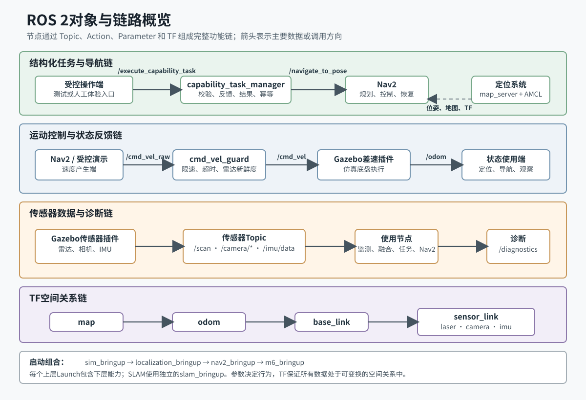

# PU1-04 对象与链路概览

> 所属PU：PU1 项目总体架构与工程资源<br>
> 教材单元：4/5<br>
> 版本：v1.0<br>
> 适用项目：`/home/ubuntu/ai_robot_ws`<br>
> 适用环境：Ubuntu 22.04、ROS 2 Humble<br>
> 学习边界：建立对象和链路的总体认识；不代替PU2至PU9对命令、模型、底盘、传感器、建图、定位、导航和任务接口的专题学习。

[TOC]

## 1. 本单元要解决什么问题

ROS 2机器人不是由一个“大程序”完成所有工作，而是由多个节点围绕接口和坐标关系协作。只记住节点名称，仍无法解释“命令从哪里来、数据到哪里去、失败时先查什么”。

完成本单元后，您应能：

1. 区分Package、Node、Topic、Message、Service、Action、Parameter和TF；
2. 指出当前项目主要节点和接口；
3. 口述运动控制、状态反馈、传感器、定位导航和结构化任务链；
4. 说明主要Launch之间的包含关系；
5. 区分已经运行的接口、接口基线中的候选项和尚未实现的预留项；
6. 根据链路断点判断首先观察哪个ROS 2对象。

[](../../assets/PU1/PU1-04_对象与链路概览.svg)

图1：当前项目的结构化任务、导航、运动、传感器、状态反馈和TF关系。

## 2. ROS 2中的主要对象

| 对象 | 回答的问题 | 本项目示例 |
|---|---|---|
| Package | 代码和资源属于哪个可构建、可安装单元 | `ai_robot_sim` |
| Node | 哪个运行进程正在承担职责 | `cmd_vel_guard` |
| Topic | 连续或事件数据怎样异步传递 | `/scan`、`/odom` |
| Message | Topic中每条数据的字段结构 | `sensor_msgs/msg/LaserScan` |
| Service | 一次短请求如何得到一次响应 | `/ai_robot/get_robot_status`仅为预留 |
| Action | 长任务怎样提供反馈、结果和取消 | `/navigate_to_pose` |
| Parameter | 节点行为怎样配置 | `max_linear_speed` |
| TF | 不同坐标系怎样建立空间关系 | `map → odom → base_link` |

这些对象彼此配合，而不是互相替代。例如，导航Action接收目标，导航节点通过Topic读取地图、雷达和里程计，通过TF换算空间关系，再通过速度Topic控制底盘。

## 3. 主要节点

### 3.1 仿真本体与模型节点

| 节点或组件 | 主要职责 |
|---|---|
| Gazebo Server | 运行世界、物理和机器人插件 |
| `robot_state_publisher` | 根据机器人描述和关节状态发布模型TF |
| Gazebo差速插件 | 接收`/cmd_vel`，驱动车轮，发布`/odom`和`odom → base_link` |
| Gazebo雷达、相机、IMU插件 | 产生仿真传感器数据 |
| `cmd_vel_guard` | 接收`/cmd_vel_raw`，执行限速、超时和雷达新鲜度保护后发布`/cmd_vel` |

### 3.2 感知与诊断节点

| 节点 | 输入 | 主要输出或作用 |
|---|---|---|
| `scan_obstacle_monitor` | `/scan` | 把最近障碍距离等状态写入`/diagnostics` |
| `camera_image_monitor` | `/camera/image_raw`、`/camera/camera_info` | 把图像尺寸、编码和相机信息状态写入`/diagnostics` |
| `ekf_filter_node` | `/odom`、`/imu/data` | 输出融合里程计`/odometry/filtered`；当前配置不发布TF |

### 3.3 建图、定位与导航节点

- SLAM模式由`async_slam_toolbox_node`生成地图并负责`map → odom`；
- 地图保存由`map_saver_server`管理；
- 定位模式由`map_server`加载已有地图，AMCL结合地图、雷达、里程计和TF估计机器人位姿并负责`map → odom`；
- Nav2由Planner、Controller、BT Navigator、Costmap、行为和Lifecycle组件协作完成目标导航；
- Nav2在当前Launch中把原始速度输出重映射到`/cmd_vel_raw`，不能绕过`cmd_vel_guard`。

### 3.4 结构化能力任务节点

`capability_task_manager`提供`/execute_capability_task` Action。它负责：

1. 校验任务ID、能力名、目标坐标系、目标范围和超时；
2. 通过实际Nav2 Action `/navigate_to_pose`执行导航；
3. 发布`VALIDATING`、`NAVIGATING`和`PERCEIVING`等阶段反馈；
4. 检查雷达、图像和安全状态；
5. 返回成功、非法、越界、导航失败、超时、取消、传感器不可用或安全触发结果；
6. 缓存任务结果，使相同任务ID可以幂等重放。

它属于阶段 1的非AI机器人能力实现，不理解自然语言，也不调用大模型。

## 4. 主要Topic、消息与QoS

### 4.1 项目接口基线

`config/ros_interface_baseline.yaml`规定：

| Topic | 消息类型 | 基线QoS | 主要责任 |
|---|---|---|---|
| `/cmd_vel` | `geometry_msgs/msg/Twist` | reliable，depth 10 | 安全监督后的底盘命令 |
| `/odom` | `nav_msgs/msg/Odometry` | reliable，depth 10 | 底盘里程计 |
| `/scan` | `sensor_msgs/msg/LaserScan` | sensor data | 激光雷达数据 |
| `/camera/image_raw` | `sensor_msgs/msg/Image` | sensor data | 相机图像 |
| `/camera/camera_info` | `sensor_msgs/msg/CameraInfo` | sensor data | 相机标定信息 |
| `/imu/data` | `sensor_msgs/msg/Imu` | sensor data | IMU数据 |
| `/diagnostics` | `diagnostic_msgs/msg/DiagnosticArray` | reliable，depth 10 | 系统诊断 |

`reliable`重视可靠送达；传感器数据常用`best_effort`，允许少量丢帧来保持实时性。发布者与订阅者的QoS必须兼容，否则“Topic名称和消息类型都对”仍可能收不到数据。

### 4.2 当前实现补充接口

| 接口 | 作用 |
|---|---|
| `/cmd_vel_raw` | Nav2或受控演示产生的未经过项目安全守卫的速度 |
| `/joint_states` | 仿真车轮关节状态 |
| `/odometry/filtered` | EKF融合后的状态估计 |
| `/safety_stop` | 能力任务管理器使用的安全停车状态 |
| `/capability_task/status` | 能力任务的文本状态观察 |

接口基线是稳定契约依据，运行时接口是当前实现事实。新增或改变公共接口时，应同时更新实现、基线和契约测试，不能只改其中一处。

## 5. Service与Action：现状不能混写

### 5.1 当前Action

- `/navigate_to_pose`：当前Nav2运行时Action；
- `/execute_capability_task`：项目自定义结构化能力Action；
- `ExecuteCapabilityTask.action`：位于`ai_robot_interfaces`，定义目标、反馈和结果。

### 5.2 候选与预留接口

接口基线中还有：

- `/ai_robot/navigate_to_pose`：标记为`candidate_for_nav2_adapter`，目前不是Nav2实际运行名称；
- `/ai_robot/get_robot_status`：标记为`reserved_until_interface_package`，当前没有对应Service接口文件和服务节点。

因此，教材不能把这两项写成当前已实现能力。候选名称表示未来可能增加适配层；预留Service表示需求边界已经记录，但实现尚不存在。

## 6. Parameter怎样影响节点行为

Parameter用于配置同一个节点实例的行为。当前例子包括：

- `cmd_vel_guard`：`max_linear_speed`、`max_angular_speed`、`command_timeout`、`require_scan`、`scan_timeout`；
- `capability_task_manager`：目标范围、传感器新鲜度、任务缓存数量；
- SLAM Toolbox：地图分辨率、更新周期和匹配参数；
- AMCL：粒子、运动模型、雷达模型和更新阈值；
- Nav2：规划器、控制器、Costmap、机器人轮廓、速度和容差。

Parameter不是Topic消息。Topic随运行持续传递数据，Parameter通常表达节点配置。安全参数和稳定配置不能在学习时随意修改。

## 7. TF坐标链及发布责任

项目基线规定：

```text
map → odom → base_link → laser_link
                       ├→ camera_link
                       └→ imu_link
```

| 变换 | 含义 | 唯一发布责任 |
|---|---|---|
| `map → odom` | 全局地图与局部连续坐标的关系 | SLAM或定位系统二选一 |
| `odom → base_link` | 机器人相对局部起点的连续运动 | 当前由Gazebo差速插件发布 |
| `base_link → sensor_link` | 传感器相对机体的固定安装关系 | `robot_state_publisher` |

一条传感器消息的`frame_id`必须能沿TF树转换到`base_link`，导航或融合节点才能把数据放到统一空间中。相同父子变换出现两个发布者会造成TF冲突。

## 8. 五条主要功能链

### 8.1 运动控制链

```text
Nav2或受控运动演示
→ /cmd_vel_raw
→ cmd_vel_guard
→ /cmd_vel
→ Gazebo差速插件
→ 车轮运动
```

“有导航目标但机器人不动”时，应从Action状态、Nav2速度输出、`/cmd_vel_raw`、安全守卫和`/cmd_vel`逐段观察。

### 8.2 状态反馈链

```text
Gazebo差速插件
→ /odom + odom → base_link
→ EKF、定位、Nav2、任务体验和观察工具
```

当前EKF还接收`/imu/data`并输出`/odometry/filtered`，但配置为`publish_tf: false`，所以不能把`odom → base_link`同时归给EKF和Gazebo。

### 8.3 传感器数据链

```text
Gazebo传感器插件
→ /scan、/camera/*、/imu/data
→ 监测节点、EKF、SLAM、AMCL、Nav2、任务管理器
→ /diagnostics或算法结果
```

传感器Topic存在不等于数据可用，还需检查更新时间、Frame、QoS、数值范围和使用端订阅。

### 8.4 定位与导航链

```text
地图 + /scan + /odom + TF
→ AMCL与Nav2
→ /navigate_to_pose
→ 路径与局部控制
→ /cmd_vel_raw
→ 安全守卫和仿真底盘
```

建图模式与已有地图定位模式都可能发布`map → odom`，因此不能同时让SLAM与AMCL承担这一职责。

### 8.5 结构化任务链

```text
受控操作端
→ /execute_capability_task
→ capability_task_manager校验
→ /navigate_to_pose
→ Nav2导航
→ 到点读取雷达和图像
→ 阶段反馈与结构化结果
```

任务管理器还读取安全状态。相同任务ID的已完成结果可直接重放，不再次驱动底盘。

## 9. 主要Launch与依赖关系

| 启动入口 | 包含或增加的能力 |
|---|---|
| `sim_bringup.launch.py` | Gazebo、模型发布、机器人生成、差速与传感器插件、速度安全守卫 |
| `slam_bringup.launch.py` | 仿真基础 + SLAM Toolbox + 地图保存 |
| `localization_bringup.launch.py` | 仿真基础 + 地图服务器 + AMCL |
| `nav2_bringup.launch.py` | 定位系统 + Nav2，并把Nav2速度输出重映射到`/cmd_vel_raw` |
| `m6_bringup.launch.py` | Nav2系统 + `capability_task_manager` |

Launch表达组合和依赖，不代表所有节点都由项目自行实现。一个Launch可以同时启动本项目节点和第三方成熟组件。

## 10. 只读观察顺序

当一条链路异常时，可按以下顺序检查：

1. 节点是否存在；
2. 目标Topic、Service或Action是否存在；
3. Topic的消息类型、发布者、订阅者和QoS是否兼容；
4. 是否持续有数据，时间戳和Frame是否合理；
5. 必需TF是否连通、是否存在重复发布；
6. 节点Parameter是否符合项目配置；
7. Launch是否启动了依赖组件；
8. 日志和`/diagnostics`是否指出具体异常。

常用只读命令：

```bash
ros2 node list
ros2 topic list -t
ros2 topic info /scan --verbose
ros2 action list -t
ros2 param list /cmd_vel_guard
ros2 run tf2_ros tf2_echo odom base_link
```

正式操作、运动和异常练习按后续PU执行；本章不直接发布任何控制命令。

## 11. 常见理解误区

### 误区1：Topic就是节点之间的一根固定连线

Topic是命名的数据通道，可以有多个发布者或订阅者；实际连接还取决于发现、类型和QoS。

### 误区2：有`/scan`名称就说明雷达链正常

还需确认发布者、数据频率、QoS、数值、时间戳、`frame_id`和TF。

### 误区3：接口基线中的每一项都已经实现

不正确。基线明确包含候选和预留项，必须结合状态字段和当前ROS图判断。

### 误区4：TF只是RViz2显示需要

不正确。SLAM、定位、融合和导航都依赖TF进行坐标变换。

### 误区5：Nav2应该直接发布`/cmd_vel`

在本项目中，Nav2输出被重映射到`/cmd_vel_raw`，经`cmd_vel_guard`后才形成`/cmd_vel`。

## 12. 本单元总结

1. ROS 2功能由节点、接口、Parameter和TF共同组成。
2. Topic适合连续数据，Service适合短请求响应，Action适合可反馈、可取消的长任务。
3. 当前项目的核心控制路径是`/cmd_vel_raw → cmd_vel_guard → /cmd_vel`。
4. 传感器、里程计、地图和TF共同支撑定位与导航。
5. `/execute_capability_task`是阶段 1的结构化能力Action，不是AI Agent。
6. 基线中的候选与预留接口不能当作当前运行事实。
7. Launch从仿真基础逐层组合定位、导航和任务能力。

## 13. 理解检查

1. Topic、Service和Action分别适合什么交互？
2. `/cmd_vel_raw`和`/cmd_vel`之间为什么必须有`cmd_vel_guard`？
3. 当前谁发布`odom → base_link`，为什么EKF不应重复发布？
4. `/scan`会被哪些类型的节点使用？
5. `/ai_robot/get_robot_status`当前是什么状态？
6. 基线中的`/ai_robot/navigate_to_pose`与当前Nav2的`/navigate_to_pose`有何区别？
7. `m6_bringup.launch.py`依次建立了哪些下层能力？
8. 出现导航目标已接受但机器人不动时，怎样沿链路检查？

完成理解检查后，再进入PU1-05“实体迁移概览”。

## 14. 项目内依据

- `config/ros_interface_baseline.yaml`
- `config/tf_frame_baseline.yaml`
- `config/ekf_sim.yaml`
- `src/ai_robot_description/urdf/ai_robot.urdf.xacro`
- `src/ai_robot_interfaces/action/ExecuteCapabilityTask.action`
- `src/ai_robot_sim/launch/`
- `src/ai_robot_sim/ai_robot_sim/cmd_vel_guard.py`
- `src/ai_robot_sim/ai_robot_sim/capability_task_manager.py`
- `src/ai_robot_sim/ai_robot_sim/scan_obstacle_monitor.py`
- `src/ai_robot_sim/ai_robot_sim/camera_image_monitor.py`

## 15. 外部参考资料

### 1. Topics, Services, and Actions

**来源**：ROS 2 Humble官方文档

**适用版本**：ROS 2 Humble

**用途**：理解Topic、Service和Action的通信模型及适用场景

**链接**：https://docs.ros.org/en/humble/Concepts/Basic/Interfaces-Topics-Services-Actions.html

**查阅日期**：2026-07-29

### 2. Quality of Service settings

**来源**：ROS 2 Humble官方文档

**适用版本**：ROS 2 Humble

**用途**：理解可靠性、历史、队列深度和传感器数据QoS

**链接**：https://docs.ros.org/en/humble/Concepts/Intermediate/About-Quality-of-Service-Settings.html

**查阅日期**：2026-07-29

### 3. REP 105: Coordinate Frames for Mobile Platforms

**来源**：ROS Enhancement Proposals

**适用版本**：ROS移动机器人通用约定

**用途**：理解`map`、`odom`和`base_link`坐标系语义

**链接**：https://www.ros.org/reps/rep-0105.html

**查阅日期**：2026-07-29

### 4. Navigation Concepts

**来源**：Nav2官方文档

**适用版本**：Nav2

**用途**：理解导航服务器、行为树、地图、定位、代价地图和恢复行为之间的关系

**链接**：https://docs.nav2.org/concepts/

**查阅日期**：2026-07-29
