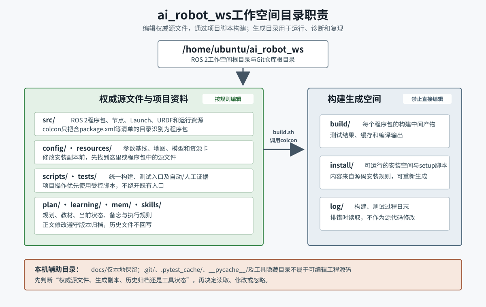

# S1-1-M0-L1-02 工作空间与目录

> 所属开发单元：S1-1-M0 工程与管理基线<br>\n> 所属学习子单元：S1-1-M0-L1 项目架构、工作空间与目录<br>
> 教材单元：2/5<br>
> 版本：v1.3<br>
> 适用项目：`/home/ubuntu/ai_robot_ws`<br>
> 适用环境：Ubuntu 22.04、ROS 2 Humble、colcon<br>
> 学习边界：只学习工作空间和目录职责，不修改工程基线，不执行仿真运动或实体机器人操作。

[TOC]

## 1. 本单元要解决什么问题

机器人项目中的同一份配置可能同时出现在源码目录和安装目录，构建后还会出现大量中间文件与日志。如果不知道哪一份是权威源文件，就容易发生“改了文件但运行结果不变”“修改被下一次构建覆盖”或“把生成文件提交到Git”等问题。

完成本单元后，您应能：

1. 确认当前是否位于项目工作空间根目录；
2. 说明`src/`、`build/`、`install/`和`log/`的区别；
3. 找到规划、教材、状态、配置、模型、地图、脚本和测试的实际位置；
4. 判断一个目录是权威源文件、构建生成空间、历史归档还是本机工具状态；
5. 知道修改源文件后为什么需要重新构建并重新加载工作空间环境；
6. 在不修改项目的前提下，用只读命令观察工作空间结构。

[](../../assets/S1-1-M0/S1-1-M0-L1-02_工作空间与目录.svg)

图1：`ai_robot_ws`目录职责。左侧是按项目规则维护的权威源文件和资料，右侧是由构建与测试过程生成的空间。图片较小时可点击查看原图。

## 2. 什么是ROS 2工作空间

ROS 2工作空间是组织、构建、安装和测试一组ROS 2程序包的目录。当前项目的工作空间根目录是：

```text
/home/ubuntu/ai_robot_ws
```

它同时也是本项目Git仓库的根目录。工作空间根目录下既包含ROS 2标准目录，也包含项目治理、教材、资源和测试目录。

### 2.1 如何确认工作空间根目录

在终端中可以执行以下只读命令：

```bash
pwd
git rev-parse --show-toplevel
```

在本项目中，两条命令预期都指向：

```text
/home/ubuntu/ai_robot_ws
```

还可以检查几个根目录标志：

```bash
test -f AGENTS.md
test -f README.md
test -d src
test -d config
test -d tests
```

这些检查没有输出且退出码为0，表示相应路径存在。单独看到一个`src/`目录并不能证明它就是本项目根目录，还应结合Git根目录和项目规则文件判断。

### 2.2 系统ROS 2与项目工作空间

本项目运行在两个叠加环境之上：

```text
/opt/ros/humble
    ↓ 系统ROS 2基础环境
/home/ubuntu/ai_robot_ws/install
    ↓ 当前项目安装空间
项目节点、Launch、接口和资源
```

构建前，项目脚本加载系统ROS 2环境：

```bash
source /opt/ros/humble/setup.bash
```

构建完成后，需要加载项目安装空间：

```bash
source /home/ubuntu/ai_robot_ws/install/setup.bash
```

加载环境只是让当前Shell能够找到已安装的程序包、可执行文件和资源，不会修改源码。

## 3. ROS 2工作空间的四个核心目录

### 3.1 `src/`：源码空间

`src/`保存供colcon发现和构建的ROS 2程序包源文件。当前`colcon list`识别出五个程序包：

```text
ai_robot_cpp_example
ai_robot_description
ai_robot_interfaces
ai_robot_py_example
ai_robot_sim
```

程序包通常通过`package.xml`以及`CMakeLists.txt`或`setup.py`声明自身。`src/`中存在目录不等于它已经是可构建程序包；例如预留目录只有在具备有效程序包清单后，才会出现在`colcon list`结果中。

`src/`中的典型权威源文件包括：

- C++和Python节点源代码；
- `package.xml`依赖与元数据；
- `CMakeLists.txt`或`setup.py`构建安装规则；
- Launch文件；
- URDF/Xacro机器人模型；
- 程序包随运行安装的世界、地图和其他资源；
- 程序包内部测试。

修改这些文件时应遵守当前里程碑、接口、安全和测试规则。

### 3.2 `build/`：构建中间空间

`build/`由colcon创建，通常按程序包保存：

- CMake缓存和编译中间产物；
- Python构建元数据；
- 测试结果；
- colcon生成的内部文件。

`build/`不是源码目录。出现编译错误时可以读取其中的测试结果或构建信息辅助诊断，但不应直接编辑里面的文件来“修复”项目。

原因是这些文件由构建过程生成，下一次构建可能覆盖修改；真正的修复应回到`src/`、`config/`或构建脚本中的权威源文件。

### 3.3 `install/`：安装与运行空间

`install/`保存构建完成后可供ROS 2运行和发现的内容，包括：

- `setup.bash`、`local_setup.bash`等环境脚本；
- 每个程序包安装后的可执行文件和Python模块；
- `share/<package>/`中的Launch、配置、模型、地图及程序包清单；
- ROS 2索引需要的资源。

当前项目使用colcon默认的隔离安装布局，因此通常能看到：

```text
install/<package_name>/
```

`install/`中的文件是安装副本，不是首选编辑位置。修改安装副本即使暂时生效，也会在重新构建后丢失，并且Git无法正确记录源文件变化。

### 3.4 `log/`：构建和测试日志空间

`log/`保存colcon构建、测试和结果汇总产生的日志。排错时常用：

```text
log/latest_build/
log/latest_test/
```

不同版本的colcon和不同命令可能生成略有不同的子目录，但基本用途相同：

- 查看实际执行的构建或测试命令；
- 查看标准输出和错误输出；
- 确定哪个程序包首先失败；
- 保留一次运行的诊断线索。

`log/`可以读取和引用为临时诊断依据，但它不是规划、源码或正式测试证据的替代品。需要长期保留的人工证据应按模板写入`tests/evidence/`。

### 3.5 四个目录之间的关系

```text
src/中的程序包源文件
        |
        | ./scripts/build.sh
        v
build/中的构建中间产物
        |
        v
install/中的可运行安装结果

构建和测试过程
        |
        v
log/中的诊断日志
```

项目的`./scripts/build.sh`明确把四个路径固定为：

```text
--base-paths   /home/ubuntu/ai_robot_ws/src
--build-base   /home/ubuntu/ai_robot_ws/build
--install-base /home/ubuntu/ai_robot_ws/install
--log-base     /home/ubuntu/ai_robot_ws/log
```

因此，本项目不依赖“当前碰巧在哪个目录执行”来猜测输出位置。

## 4. 项目扩展目录的实际职责

ROS 2只规定工作空间和程序包构建机制。完整机器人项目还需要规划、配置、测试、教材和证据管理。本项目根目录中的主要路径如下。

| 路径 | 当前职责 | 典型内容 | 是否直接编辑 |
|---|---|---|---|
| `src/` | ROS 2程序包源码 | 节点、Launch、Action、URDF、世界和程序包资源 | 按任务和规则编辑 |
| `config/` | 跨程序包配置基线 | 接口、TF、底盘、传感器、EKF、SLAM、AMCL参数 | 按任务和测试编辑 |
| `resources/` | 项目级工程资源 | 对象资源矩阵、第三方资源卡；预留地图和模型目录 | 按资源流程编辑 |
| `scripts/` | 统一操作入口 | 环境检查、构建、测试、人工体验和教材渲染脚本 | 审查后编辑 |
| `tests/` | 工作空间级验证 | 单元、Launch、契约、场景测试和证据模板 | 按测试目标编辑 |
| `plan/` | 当前有效规划 | 总计划、ROS 2规划、学习计划 | 正文修改必须升版归档 |
| `plan/bks/` | 历史规划 | 被新版本替代的规划 | 只读，不回写历史 |
| `learning/` | 正式学习教材体系 | Markdown源稿、图片、HTML和教材归档 | 按教材版本规则编辑 |
| `mem/当前状态.md` | 当前动态状态 | 当前阶段、目标、依据、风险和下一步 | 状态变化时更新 |
| `mem/备忘-*.md` | 历史决策与结果 | 任务结论、验证结果和纠错记录 | 新建后不改历史 |
| `skills/` | 执行与会话规则 | `会话管理协议.md` | 修改前备份并升版 |
| `docs/` | 本地参考与规则备份 | 技术参考、原稿和备份 | 本地使用，不上传GitHub |
| `README.md` | 项目入口说明 | 环境、目录、命令和安全边界 | 按项目变化更新 |
| `AGENTS.md` | 项目执行规则 | 启动、版本、测试和安全要求 | 修改前备份并升版 |

### 4.1 配置在哪里

当前主要配置位于`config/`根目录，例如：

```text
config/ros_interface_baseline.yaml
config/tf_frame_baseline.yaml
config/sim_base.yaml
config/sim_sensors.yaml
config/ekf_sim.yaml
config/slam_sim.yaml
config/amcl_sim.yaml
```

这些文件是项目维护的配置源。`ai_robot_sim/setup.py`在构建时把部分配置安装到：

```text
install/ai_robot_sim/share/ai_robot_sim/config/
```

如果运行时使用安装后的配置，应修改`config/`中的源文件、重新构建，再重新加载工作空间；不要把`install/.../config/`当成长期编辑位置。

### 4.2 模型、世界和地图在哪里

机器人模型源文件：

```text
src/ai_robot_description/urdf/ai_robot.urdf.xacro
```

当前仿真世界和导航地图：

```text
src/ai_robot_sim/worlds/s1_m5_navigation.world
src/ai_robot_sim/maps/s1_m5_navigation.yaml
src/ai_robot_sim/maps/s1_m5_navigation.pgm
```

这些资源属于程序包运行内容，构建后会安装到对应程序包的`share/`目录。`resources/maps/`和`resources/models/`是项目级资源预留位置；判断实际运行使用哪一份资源时，应继续查看Launch文件和程序包安装规则，不能只根据目录名称猜测。

### 4.3 操作入口和测试在哪里

统一入口：

```text
scripts/check_environment.sh
scripts/build.sh
scripts/test.sh
scripts/start_m5_m6_manual_experience.sh
```

测试目录按责任范围划分：

```text
src/<package>/test/  单包单元、资源契约和包级Launch测试
tests/contract/      工作空间公共接口、配置和结构契约
tests/integration/   多包、ROS图和第三方组件组合测试
tests/system/        整机端到端与Gate测试
tests/scenario/      人工场景与观察说明
tests/evidence/      rosbag和人工证据模板
```

完整规则见`tests/README.md`。执行项目前应优先采用已经审查的脚本和测试入口。直接拼接一组不同参数的命令，可能绕过项目环境选择、安全入口或证据要求。

## 5. 权威源文件与安装副本

判断一个文件是否应该修改，可以沿以下顺序检查：

```text
文件位于build/、install/或log/？
    |
    +-- 是：默认视为生成文件，只读观察
    |
    +-- 否：它是否位于plan/bks/、教材bks/或历史备忘？
            |
            +-- 是：历史归档，只读
            |
            +-- 否：它是否位于src/、config/、scripts/、tests/等受管目录？
                    |
                    +-- 是：可能是权威源文件，但仍需符合当前任务和修改规则
                    |
                    +-- 否：先查README、规划和Git状态，不猜测
```

一个实用判断是查看文件是否被Git跟踪：

```bash
git ls-files -- path/to/file
```

有输出表示它被Git管理，但“被Git管理”不自动等于“当前任务允许修改”。例如历史规划同样被Git管理，却不能回写。

## 6. 可以编辑、只读观察和应当忽略的目录

### 6.1 可以按任务编辑

- `src/`中的程序包源文件；
- `config/`中的配置源；
- `scripts/`中的项目脚本；
- `tests/`中的测试和证据模板；
- `resources/`中的受控资源；
- 当前有效的`plan/`、`learning/`、`mem/当前状态.md`和规则文件，但必须遵守各自版本要求。

“可以编辑”不表示可以随意修改。仍需有明确任务、保留版本历史并执行相应测试。

### 6.2 只读观察或按流程再生

- `build/`；
- `install/`；
- `log/`；
- `plan/bks/`；
- 课程`bks/`；
- 已形成的历史备忘。

前三项是构建生成空间，后三项是历史记录。它们只读的原因不同，不能混为一类。

### 6.3 不作为工程源码的本机目录

- `.git/`：Git内部数据库，不手工编辑；
- `.pytest_cache/`、`__pycache__/`：测试或Python缓存；
- `.agents/`、`.codex/`：工具管理的隐藏状态，不作为当前项目规划和源码依据；
- `docs/`：本项目约定为本地参考与备份目录，被`.gitignore`排除，不上传GitHub。

缓存和工具状态即使出现在工作空间根目录，也不属于机器人功能实现。

## 7. 只读观察方法

以下命令用于学习和定位，不修改工程：

### 7.1 查看顶层结构

```bash
find . -maxdepth 1 -mindepth 1 -printf '%f\n' | sort
```

### 7.2 列出Git管理的文件

```bash
git ls-files
```

### 7.3 快速查找文件

```bash
rg --files src config scripts tests resources
```

例如查找Launch文件：

```bash
rg --files src tests | rg 'launch|launch.py'
```

### 7.4 列出colcon识别的程序包

```bash
source /opt/ros/humble/setup.bash
colcon list
```

当前预期识别五个程序包。程序包职责和内部结构将在S1-1-M1-L1-01详细学习。

### 7.5 检查当前修改

```bash
git status --short
```

学习观察开始和结束时都可以执行。若出现未预期修改，应先停止并确定来源，不应直接删除或覆盖。

## 8. 常见问题与首查位置

### 8.1 修改了配置，但运行结果没有变化

首查：

1. 修改的是`config/`或程序包中的源文件，还是`install/`副本；
2. 修改后是否重新执行`./scripts/build.sh`；
3. 当前Shell是否重新加载`install/setup.bash`；
4. Launch文件实际引用的是哪个路径。

### 8.2 `ros2 run`或`ros2 launch`找不到项目程序包

首查：

1. `./scripts/build.sh`是否通过；
2. `install/setup.bash`是否存在；
3. 当前终端是否加载系统ROS 2和项目安装空间；
4. `colcon list`是否能识别相应程序包。

### 8.3 一个`src/`子目录没有出现在`colcon list`

目录可能只是预留边界，还没有`package.xml`和构建清单。不要因为目录名像程序包就假定它已经可构建。

### 8.4 Git中没有看到`build/`、`install/`和`log/`

这是正常现象。这三个目录由构建过程生成，已经写入`.gitignore`，不应作为普通源码提交。

### 8.5 在`docs/`中看到重要文件，为什么Git没有跟踪

本项目根据用户要求把`docs/`作为本地参考和备份目录，不上传GitHub。当前有效规划、教材、状态和规则应分别从`plan/`、`learning/`、`mem/`、`skills/`和`AGENTS.md`读取，不能把`docs/`中的原稿自动当成有效版本。

## 9. 本单元总结

1. `/home/ubuntu/ai_robot_ws`同时是ROS 2工作空间根目录和Git仓库根目录。
2. `src/`保存程序包源文件，`build/`保存中间产物，`install/`保存可运行安装结果，`log/`保存构建和测试日志。
3. 修改应回到权威源文件；`build/`、`install/`和`log/`不得作为长期编辑位置。
4. `config/`、`resources/`、`scripts/`和`tests/`分别管理配置、工程资源、受控入口和验证。
5. `plan/`、`learning/`、`mem/`和`skills/`分别管理规划、教材、状态备忘和执行规则，并有不同的版本与历史保护要求。
6. 同名文件出现于源码和安装空间时，应通过Launch引用与安装规则确认真实来源。

## 10. 理解检查

请用自己的话回答：

1. 如何确认当前终端位于本项目工作空间根目录？
2. `src/`、`build/`、`install/`和`log/`各自保存什么？
3. 为什么不能直接修改`install/ai_robot_sim/share/ai_robot_sim/config/`中的配置？
4. 当前机器人模型、仿真世界和导航地图的源文件分别在哪里？
5. `plan/bks/`与`build/`都不应直接修改，但原因有什么不同？
6. 一个`src/`子目录为什么可能不会出现在`colcon list`结果中？
7. 如果修改源码后`ros2 launch`仍使用旧行为，应依次检查哪些位置？

完成理解检查后，先进入S1-1-M0-L2“环境、构建、运行与项目管理”；完成M0学习后再进入S1-1-M1-L1-01“程序包与工程资源”。

## 11. 项目内依据

- `README.md`
- `.gitignore`
- `AGENTS.md`
- `plan/AI机器人开发项目计划_v1.16.md`
- `plan/ROS2机器人开发规划_v1.11.md`
- `plan/ROS2仿真机器人学习计划_v1.7.md`
- `tests/README.md`
- `scripts/build.sh`
- `scripts/test.sh`
- `src/ai_robot_sim/setup.py`
- `tests/test_workspace_layout.sh`
- `learning/README.md`
- `learning/ROS2仿真机器人/README.md`

## 12. 外部参考资料

| 资料名称 | 来源 | 适用版本 | 用途 | 链接 | 查阅日期 |
|---|---|---|---|---|---|
| What is a Workspace? | colcon官方文档 | colcon | 理解源码、构建、安装和日志空间 | https://colcon.readthedocs.io/en/released/user/what-is-a-workspace.html | 2026-07-29 |
| Quick start | colcon官方文档 | colcon | 理解`list`、`build`、`test`和环境加载顺序 | https://colcon.readthedocs.io/en/main/user/quick-start.html | 2026-07-29 |
| Log Files | colcon官方文档 | colcon | 理解构建与测试日志目录 | https://colcon.readthedocs.io/en/released/user/log-files.html | 2026-07-29 |

外部资料用于解释colcon通用机制。本项目实际目录、构建参数、版本管理和安全边界以“项目内依据”为准。
