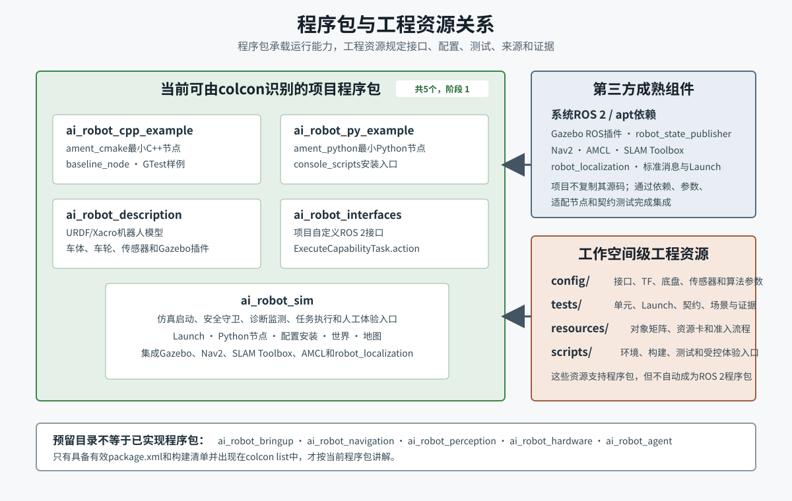

# S1-1-M1-L1-01 程序包与工程资源

> 所属开发单元：S1-1-M1 资源、接口与测试基线<br>\n> 所属学习子单元：S1-1-M1-L1 程序包与工程资源<br>
> 教材单元：3/5<br>
> 版本：v1.0<br>
> 适用项目：`/home/ubuntu/ai_robot_ws`<br>
> 适用环境：Ubuntu 22.04、ROS 2 Humble<br>
> 学习边界：认识当前程序包和工程资源，不把预留目录或阶段 2模块写成已实现功能。

[TOC]

## 1. 本单元要解决什么问题

工作空间中的“目录”“ROS 2程序包”“可执行节点”“第三方依赖”和“工程资源”不是同一个概念。一个目录可以只是预留边界；一个程序包可以安装多个节点和Launch；配置与测试也可能位于程序包之外。

完成本单元后，您应能：

1. 用`colcon list`确认当前真实程序包，而不是根据目录名猜测；
2. 说明五个项目程序包的职责、构建类型和关键文件；
3. 找到节点、Launch、配置、URDF/Xacro、世界、地图和测试入口；
4. 区分项目自研程序包、第三方成熟组件和工作空间级工程资源；
5. 根据一个功能需求判断首先查看哪个程序包或资源目录；
6. 说明为什么预留的`ai_robot_hardware`或`ai_robot_agent`目录不是当前实现。

[](../../assets/S1-1-M1/S1-1-M1-L1-01_程序包与工程资源.svg)

图1：当前五个程序包、第三方成熟组件和工作空间级工程资源的关系。

## 2. 如何认定一个ROS 2程序包

本项目以colcon实际识别结果为准：

```bash
source /opt/ros/humble/setup.bash
colcon list
```

当前结果为：

```text
ai_robot_cpp_example
ai_robot_description
ai_robot_interfaces
ai_robot_py_example
ai_robot_sim
```

程序包至少需要有效的`package.xml`，并根据构建类型提供`CMakeLists.txt`或`setup.py`等构建清单。

以下目录目前只是规划中的职责边界：

```text
src/ai_robot_bringup/
src/ai_robot_navigation/
src/ai_robot_perception/
src/ai_robot_hardware/
src/ai_robot_agent/
```

它们没有出现在当前`colcon list`结果中，因此不能说这些程序包已经建立，更不能把其中规划的功能当成当前能力。特别是`ai_robot_agent`属于阶段 2边界，当前没有实现。

## 3. 五个当前程序包

### 3.1 `ai_robot_cpp_example`

**定位**：S1-1-M1建立的最小C++节点和单元测试样例。

**构建类型**：`ament_cmake`。

关键文件：

```text
src/ai_robot_cpp_example/
├── package.xml
├── CMakeLists.txt
├── include/ai_robot_cpp_example/status_formatter.hpp
├── src/baseline_node.cpp
└── test/test_status_formatter.cpp
```

安装后的可执行入口：

```text
ros2 run ai_robot_cpp_example baseline_node
```

测试使用`ament_cmake_gtest`。这个包的目的不是实现机器人业务，而是证明C++程序包、节点、安装和GTest链路可工作。

### 3.2 `ai_robot_py_example`

**定位**：S1-1-M1建立的最小Python节点样例。

**构建类型**：`ament_python`。

关键文件：

```text
src/ai_robot_py_example/
├── package.xml
├── setup.py
├── setup.cfg
├── resource/ai_robot_py_example
└── ai_robot_py_example/
    ├── __init__.py
    └── baseline_node.py
```

`setup.py`通过`console_scripts`建立：

```text
baseline_node = ai_robot_py_example.baseline_node:main
```

安装后的入口：

```text
ros2 run ai_robot_py_example baseline_node
```

工作空间级Python测试位于：

```text
tests/unit/test_python_example.py
```

### 3.3 `ai_robot_description`

**定位**：机器人几何、关节、传感器安装关系和Gazebo仿真插件描述。

**构建类型**：`ament_cmake`。

当前核心文件：

```text
src/ai_robot_description/urdf/ai_robot.urdf.xacro
```

模型包含：

- `base_footprint`与`base_link`；
- 左右车轮及连续关节；
- `laser_link`、`camera_link`和`imu_link`；
- 差速底盘、关节状态、雷达、相机和IMU Gazebo插件。

`CMakeLists.txt`把`urdf/`和`launch/`目录安装到程序包`share`空间。当前该包的`launch/`没有有效Launch文件；模型由`ai_robot_sim/launch/sim_bringup.launch.py`读取并启动。

这说明“模型属于description包”和“总启动入口属于sim包”可以同时成立。

### 3.4 `ai_robot_interfaces`

**定位**：项目自定义ROS 2接口定义。

**构建类型**：`ament_cmake`加`rosidl_default_generators`。

当前接口：

```text
src/ai_robot_interfaces/action/ExecuteCapabilityTask.action
```

它定义阶段 1机器人能力Action的目标、反馈和结果，包括任务ID、能力名、目标位姿、超时、传感器要求、执行阶段和结果枚举。

该Action是ROS 2机器人能力契约，不是阶段 2的完整AI—ROS 2任务接口层。接口包不包含任务执行逻辑，实际执行端位于`ai_robot_sim`。

### 3.5 `ai_robot_sim`

**定位**：当前仿真机器人集成包。

**构建类型**：`ament_python`。

它承担四类工作：

1. 安装和启动Gazebo、模型、定位、导航及任务链；
2. 提供项目自研的安全、监测、任务和体验节点；
3. 安装仿真配置、世界和地图；
4. 组合第三方成熟组件形成可测试系统。

Python可执行入口：

| 可执行入口 | 源文件 | 作用 |
|---|---|---|
| `cmd_vel_guard` | `cmd_vel_guard.py` | 限速、命令超时和雷达新鲜度保护 |
| `scan_obstacle_monitor` | `scan_obstacle_monitor.py` | 雷达障碍距离诊断 |
| `camera_image_monitor` | `camera_image_monitor.py` | 图像与相机信息诊断 |
| `capability_task_manager` | `capability_task_manager.py` | 非AI能力任务执行、反馈和结果 |
| `manual_motion_demo` | `manual_motion_demo.py` | 受控仿真运动演示 |
| `manual_m5_m6_experience` | `manual_m5_m6_experience.py` | M5/M6人工体验入口 |

Launch入口：

| Launch文件 | 主要组合 |
|---|---|
| `sim_bringup.launch.py` | Gazebo、模型、`robot_state_publisher`、生成机器人、速度安全守卫 |
| `slam_bringup.launch.py` | 仿真基础、SLAM Toolbox、地图保存和生命周期管理 |
| `localization_bringup.launch.py` | 仿真基础、静态地图、AMCL和生命周期管理 |
| `nav2_bringup.launch.py` | 定位系统、Nav2导航栈、速度输出重映射 |
| `m6_bringup.launch.py` | Nav2系统和`capability_task_manager` |

包内运行资源：

```text
src/ai_robot_sim/worlds/s1_m5_navigation.world
src/ai_robot_sim/maps/s1_m5_navigation.yaml
src/ai_robot_sim/maps/s1_m5_navigation.pgm
```

`setup.py`还会把根目录`config/`中的仿真配置安装到`share/ai_robot_sim/config/`。

## 4. 每个程序包中的资源类型

### 4.1 `package.xml`

`package.xml`记录名称、版本、许可证、维护者、构建工具和依赖。例如：

- `ai_robot_cpp_example`依赖`rclcpp`；
- `ai_robot_py_example`依赖`rclpy`；
- `ai_robot_description`运行时依赖Xacro、`robot_state_publisher`和Gazebo插件；
- `ai_robot_interfaces`依赖消息生成工具和`geometry_msgs`；
- `ai_robot_sim`依赖项目接口、标准消息、Nav2消息、Gazebo ROS和Launch。

它是包级依赖依据，不应只根据Python `import`或C++ `#include`猜依赖。

### 4.2 `CMakeLists.txt`与`setup.py`

二者负责把源码变成安装空间中的可执行文件和资源：

- CMake包使用`add_executable`、`install`和`ament_package`；
- Python包使用`setuptools.setup`、`data_files`和`console_scripts`；
- 自定义接口包使用`rosidl_generate_interfaces`。

如果文件存在于源码中却没有被安装，运行时通过`ros2 run`或`get_package_share_directory`可能找不到它。

### 4.3 节点源文件

节点源文件实现运行逻辑。一个Python文件不一定安装为可执行节点，必须查看`setup.py`中的`console_scripts`；一个C++源文件也必须由CMake创建并安装目标。

### 4.4 Launch文件

Launch用于声明参数、包含其他Launch、启动节点、设置重映射和选择资源。它表达“哪些组件以什么组合启动”，不是组件内部算法实现。

### 4.5 配置、模型、世界和地图

资源可能位于包内，也可能由工作空间根目录统一管理后安装进包：

- URDF/Xacro：`ai_robot_description/urdf/`；
- 世界和地图：`ai_robot_sim/worlds/`、`ai_robot_sim/maps/`；
- 当前仿真参数源：根目录`config/`；
- 安装副本：`install/<package>/share/<package>/...`。

## 5. 工作空间级工程资源

### 5.1 配置基线

`config/`不仅保存运行参数，也保存接口与TF契约：

```text
config/ros_interface_baseline.yaml
config/tf_frame_baseline.yaml
config/sim_base.yaml
config/sim_sensors.yaml
config/ekf_sim.yaml
config/slam_sim.yaml
config/amcl_sim.yaml
```

接口基线规定名称、消息和QoS；TF基线规定Frame及唯一发布职责；其他YAML规定仿真和算法参数。

### 5.2 测试资源

`tests/`按风险和范围组织：

- `unit/`：普通逻辑和最小节点；
- `launch/`：多节点及仿真启动测试；
- `contract/`：接口、配置、文件结构和约束；
- `scenario/`：人工观察与体验说明；
- `evidence/`：rosbag和人工证据模板。

包内测试与工作空间级测试互补：前者紧贴包内代码，后者验证跨包契约和完整链路。

### 5.3 资源矩阵与准入卡

必须阅读：

```text
resources/S1-1-M1对象资源矩阵.md
resources/S1-1-M1第三方资源卡与准入流程.md
```

对象资源矩阵回答：

- 机器人对象是什么；
- 候选成熟资源是什么；
- 仿真和实体分别怎样实现；
- 用什么方法测试。

资源卡记录来源、许可证、版本、兼容性、接口、资源需求、测试和回退。第三方组件进入项目依赖前必须经过准入流程。

### 5.4 统一脚本

`scripts/`固定环境、构建、测试和人工体验入口。脚本不属于ROS 2程序包，但保证多个程序包以一致方式构建和验收。

## 6. 项目自研与第三方组件的边界

### 6.1 项目自研或项目维护

- 五个`ai_robot_*`有效程序包；
- 项目Action定义；
- 安全守卫、监测、任务执行和人工体验节点；
- 项目Launch组合、参数、模型、地图和世界；
- 接口、TF、资源和测试基线。

### 6.2 第三方成熟组件

当前系统通过Ubuntu/ROS 2安装使用：

- Gazebo Classic和`gazebo_ros`插件；
- `robot_state_publisher`与Xacro；
- `robot_localization`；
- SLAM Toolbox；
- Nav2、AMCL和地图服务器；
- ROS 2标准消息、Launch和生命周期组件。

本仓库不复制这些组件的上游源码。项目主要通过以下方式集成：

```text
package.xml依赖
→ Launch组合
→ YAML参数
→ Topic/Action重映射
→ 薄封装节点
→ 契约、Launch和场景测试
```

第三方组件内部算法通常不在本项目重复做白盒测试；本项目重点验证版本、启动、接口、参数、异常行为、安全边界和系统集成。

## 7. 根据功能需求查找资源

| 想查的问题 | 首查位置 | 继续追踪 |
|---|---|---|
| 机器人形状、轮距或传感器安装 | `ai_robot_description/urdf/` | TF基线、Gazebo插件配置 |
| 速度为何被限制或停车 | `cmd_vel_guard.py` | `config/sim_base.yaml`、安全Launch测试 |
| 雷达或相机是否有数据 | URDF传感器插件 | `sim_sensors.yaml`、监测节点和传感器测试 |
| 系统怎样启动 | `ai_robot_sim/launch/` | 被包含的第三方Launch和安装资源 |
| 导航任务怎样进入系统 | `ExecuteCapabilityTask.action` | `capability_task_manager.py`、M6测试 |
| 地图从哪里加载 | `localization_bringup.launch.py` | `ai_robot_sim/maps/` |
| 接口名称和QoS依据 | `ros_interface_baseline.yaml` | 契约测试和节点源文件 |
| 第三方组件能否采用 | 资源卡与准入流程 | 版本、许可证、最小验证和回退 |

## 8. 只读观察方法

```bash
source /opt/ros/humble/setup.bash
colcon list
```

查看一个包的源文件：

```bash
rg --files src/ai_robot_sim
```

查看包清单中的依赖：

```bash
sed -n '1,180p' src/ai_robot_sim/package.xml
```

查看Python可执行入口：

```bash
rg -n 'console_scripts|=' src/ai_robot_sim/setup.py
```

查看Launch组合：

```bash
rg -n 'package=|executable=|IncludeLaunchDescription' src/ai_robot_sim/launch
```

这些命令只用于观察。正式学习练习仍按学习计划逐步执行和记录证据。

## 9. 常见理解误区

### 误区1：`src/`下每个目录都是ROS 2程序包

不是。以`colcon list`和有效构建清单为准。

### 误区2：一个功能只对应一个文件

通常不是。例如导航涉及Launch、Nav2参数、地图、TF、传感器、安全守卫和测试。

### 误区3：第三方组件不需要项目测试

不正确。可以不重复上游内部算法白盒测试，但必须验证本项目使用的版本、接口、参数和异常边界。

### 误区4：`ai_robot_interfaces`已经实现任务执行

不是。接口包只定义契约；执行逻辑在`capability_task_manager`。

### 误区5：预留`ai_robot_agent`目录表示AI Agent已接入

不是。阶段 2尚未开始，预留目录不构成实现。

## 10. 本单元总结

1. 当前工作空间有五个有效项目程序包。
2. C++包、Python包、模型包、接口包和仿真集成包承担不同职责。
3. 节点是否可运行取决于构建和安装入口，不只取决于源文件存在。
4. Launch负责组合，配置负责参数，测试负责验证，资源卡负责第三方准入。
5. 项目通过依赖、参数、适配和测试复用成熟组件，不把第三方源码直接混入自研包。
6. 规划中的预留目录和阶段 2模块不能当作当前实现。

## 11. 理解检查

1. 当前五个有效程序包分别是什么？
2. `ai_robot_description`为什么不负责仿真总启动？
3. `ai_robot_interfaces`和`ai_robot_sim`在能力任务中分别负责什么？
4. 如何确认一个Python文件已安装为ROS 2可执行入口？
5. 根目录`config/`为什么能出现在`ai_robot_sim`安装空间？
6. 包内测试与工作空间级契约测试有什么区别？
7. 项目复用Nav2或SLAM Toolbox时仍需验证哪些内容？
8. 为什么`ai_robot_hardware`和`ai_robot_agent`当前不能列为有效程序包？

完成理解检查后，再进入S1-1-M1-L2-01“对象与链路概览”。

## 12. 项目内依据

- `src/*/package.xml`
- `src/ai_robot_cpp_example/CMakeLists.txt`
- `src/ai_robot_py_example/setup.py`
- `src/ai_robot_description/CMakeLists.txt`
- `src/ai_robot_interfaces/CMakeLists.txt`
- `src/ai_robot_sim/setup.py`
- `src/ai_robot_sim/launch/`
- `config/ros_interface_baseline.yaml`
- `config/tf_frame_baseline.yaml`
- `resources/S1-1-M1对象资源矩阵.md`
- `resources/S1-1-M1第三方资源卡与准入流程.md`
- `tests/`

## 13. 外部参考资料

### 1. Creating your first ROS 2 package

**来源**：ROS 2 Humble官方文档

**适用版本**：ROS 2 Humble

**用途**：理解`package.xml`、`ament_cmake`和`ament_python`程序包结构

**链接**：https://docs.ros.org/en/humble/Tutorials/Beginner-Client-Libraries/Creating-Your-First-ROS2-Package.html

**查阅日期**：2026-07-29

### 2. Launch

**来源**：ROS 2 Humble官方文档

**适用版本**：ROS 2 Humble

**用途**：理解Launch如何组合节点、参数、重映射和其他Launch文件

**链接**：https://docs.ros.org/en/humble/Tutorials/Intermediate/Launch/Launch-Main.html

**查阅日期**：2026-07-29

外部资料用于理解通用程序包和Launch机制；当前程序包数量、文件、职责和安装规则以本项目源码为准。
