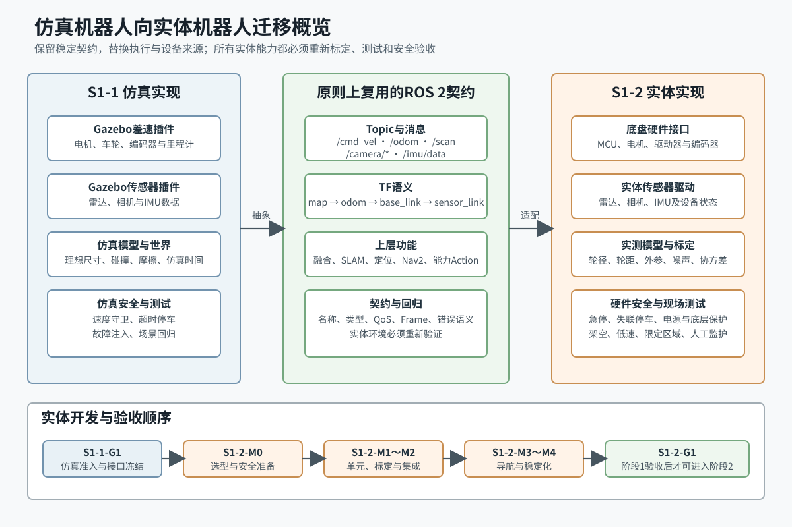

# S1-1-M1-L3-01 实体迁移概览

> 所属开发单元：S1-1-M1 资源、接口与测试基线<br>\n> 所属学习子单元：S1-1-M1-L3 仿真到实体的接口基线<br>
> 教材单元：5/5<br>
> 版本：v1.0<br>
> 适用项目：`/home/ubuntu/ai_robot_ws`<br>
> 适用环境：Ubuntu 22.04、ROS 2 Humble<br>
> 学习边界：只建立仿真到实体的总体迁移认识；不确定硬件品牌，不开发驱动，不对实体机器人上电、运动、发布控制命令或执行硬件测试。

[TOC]

## 1. 本单元要解决什么问题

从仿真机器人迁移到实体机器人，不是把Gazebo关闭后启动几个驱动就结束。正确目标是：

> 尽量保持经过验收的ROS 2接口和上层能力稳定，用实体底盘、传感器驱动及硬件安全机制替换仿真执行来源，再在真实物理条件下重新标定和验收。

完成本单元后，您应能：

1. 说明仿真插件与实体设备或驱动的大致对应关系；
2. 区分原则上可复用、必须替换和必须新增的内容；
3. 解释为什么相同Topic名称不代表实体能力自动通过；
4. 说明实体阶段必须补充的协议、标定、电源、时延和安全工作；
5. 说明`S1-1-G1`、`S1-2-M0`至`S1-2-M4`、`S1-2-G1`的顺序；
6. 明确当前学习不构成任何实体硬件操作授权。

[](../../assets/S1-1-M1/S1-1-M1-L3-01_实体迁移概览.svg)

图1：从仿真实现经过稳定ROS 2契约迁移到实体实现，并重新完成安全与能力验收。

## 2. 三类迁移内容

### 2.1 原则上可复用

在接口契约保持兼容的前提下，以下内容原则上可继续使用：

- Topic、消息、Action及错误语义；
- `map → odom → base_link → sensor_link`的TF语义；
- `robot_state_publisher`及机器人描述组织方式；
- `robot_localization`融合框架；
- SLAM Toolbox、地图管理、AMCL和Nav2；
- 阶段 1结构化能力Action与任务状态逻辑；
- Launch组合方式、诊断框架、rosbag流程和测试分层；
- 面向公共接口的契约测试和一部分场景测试。

“原则上可复用”有两个前提：

1. `S1-1-G1`对实体接口形成明确冻结结论；
2. 实体实现重新通过接口、时序、精度、安全和场景验收。

它不表示配置无需改变，也不表示仿真测试结果可以替代实体测试。

### 2.2 必须替换

| 仿真实现 | 实体实现方向 | 保持的抽象 |
|---|---|---|
| Gazebo差速插件 | MCU通信、底盘硬件接口、电机驱动和编码器 | 接收安全速度，发布里程计和设备状态 |
| Gazebo雷达插件 | 具体雷达的ROS 2驱动或适配节点 | 发布`LaserScan`及正确Frame |
| Gazebo相机插件 | USB、网络或专用相机驱动 | 发布图像和相机标定信息 |
| Gazebo IMU插件 | 实体IMU驱动 | 发布角速度、加速度、方向和协方差 |
| Gazebo世界与物理 | 真实场地、摩擦、载荷和动态障碍 | 上层场景目标与安全约束 |
| 仿真时间 | 系统时钟及可能的设备硬件时钟 | 时间戳单调、可比较、可同步 |

替换的是数据和执行的来源，不是随意更改公共接口。

### 2.3 必须新增或强化

实体阶段必须增加仿真无法完整代表的内容：

- MCU协议、串口、CAN、USB或Ethernet通信；
- 电机驱动、编码器计数、设备状态和底层故障码；
- 电源、电池、保险、供电裕量、散热和带宽核算；
- 硬件急停、安全回路、通信失联停车和底层速度限制；
- 真实尺寸、轮径、轮距、传感器外参和IMU方向标定；
- 时延、丢包、抖动、断连、温度、供电和设备重连测试；
- 架空、低速、限定区域和有人监护的现场测试流程；
- 安装、维护、故障诊断、版本锁定和回退证据。

## 3. 底盘迁移

### 3.1 仿真阶段

当前Gazebo差速插件：

- 接收`/cmd_vel`；
- 根据轮径、轮距和动力学驱动车轮；
- 发布`/odom`；
- 发布`odom → base_link`；
- 由关节状态插件发布车轮关节状态。

### 3.2 实体阶段

实体底盘通常需要一个硬件驱动或`ros2_control`硬件组件：

```text
/cmd_vel
→ 安全监督
→ 底盘控制器或硬件接口
→ MCU协议
→ 电机驱动器
→ 电机与车轮

编码器
→ MCU或驱动
→ 硬件接口
→ /odom与设备状态
```

具体采用哪种控制器、总线和协议，要在硬件选型后决定。当前教材不能把`ros2_control`、CAN或某个厂商驱动写成已确定方案。

### 3.3 必须重新验证

- 左右轮方向、编码器正负号和计数比例；
- 真实轮径、轮距、减速比和速度上限；
- 直线、转向、停车和制动距离；
- 命令超时、通信失联、驱动故障和急停；
- 里程计方向、尺度、协方差和TF发布责任；
- 地面摩擦、轮滑、负载、电量对运动的影响。

## 4. 传感器迁移

### 4.1 雷达

仿真雷达插件被实体雷达驱动替换，但上层仍希望获得：

```text
/scan
sensor_msgs/msg/LaserScan
frame_id: laser_link
```

实体阶段需验证扫描角度、距离范围、频率、遮挡、反射异常、时间戳、QoS和安装外参。

### 4.2 相机

仿真相机插件被实体相机驱动替换，上层接口原则上保持`/camera/image_raw`和`/camera/camera_info`。实体阶段还需处理曝光、畸变、帧率、编码、带宽、标定、USB或网络稳定性。

### 4.3 IMU

仿真IMU插件被实体IMU驱动替换。必须核对坐标轴方向、单位、重力、零偏、漂移、协方差、时间戳和安装方向。错误的轴向或协方差会直接影响EKF、定位和导航。

### 4.4 编码器

仿真插件内部生成的轮运动反馈，在实体阶段来自真实编码器。需要确认：

- 每转计数与减速比；
- 左右轮正方向；
- 溢出和重置；
- 采样频率与通信时延；
- 断线、跳变和异常计数处理。

## 5. 模型、TF与标定迁移

URDF/Xacro结构可以继续使用，但参数必须依据实物测量更新：

- 机体长宽高、质量、重心和惯量；
- 轮径、轮宽、轮距和轮轴位置；
- 雷达、相机和IMU相对`base_link`的位置与姿态；
- 碰撞轮廓和Nav2机器人Footprint；
- 传感器外参及其测量方法。

TF Frame名称和语义应保持稳定，但变换数值必须来自真实安装。实体设备驱动发布的消息`frame_id`必须与TF树一致。

## 6. 上层算法如何复用

### 6.1 融合

`robot_localization`可以继续融合编码器里程计和IMU，但输入噪声、协方差、频率和异常特性已经改变，必须重新配置和验证。

### 6.2 SLAM与定位

SLAM Toolbox、地图服务器和AMCL可以继续使用，但实体环境会带来真实反射、轮滑、动态人员、时间同步和计算资源限制。地图精度与定位稳定性必须在目标场地实测。

### 6.3 Nav2

Nav2的软件结构和Action原则上可复用，但至少要重新核对：

- 机器人尺寸和Footprint；
- 速度、加速度、转向与制动距离；
- 里程计与定位误差；
- 全局和局部Costmap；
- 障碍层、膨胀半径、规划器和控制器；
- 网络、设备故障和安全停车对导航的影响。

### 6.4 结构化能力任务

`ExecuteCapabilityTask`的任务ID、目标、反馈、结果和错误语义原则上可以继续使用。底层导航、感知、设备状态和安全证据必须换成实体系统的真实结果，并在`S1-2-G1`前完成冻结和验收。

## 7. 接口稳定不等于参数不变

迁移时可保持：

```text
/cmd_vel        geometry_msgs/msg/Twist
/odom           nav_msgs/msg/Odometry
/scan           sensor_msgs/msg/LaserScan
/camera/*       sensor_msgs图像接口
/imu/data       sensor_msgs/msg/Imu
```

但以下内容通常必须重新确定：

- QoS是否适应实体网络和设备发布方式；
- 发布频率、时延、超时和数据新鲜度阈值；
- 速度、加速度和安全距离；
- 传感器噪声、协方差和滤波参数；
- TF数值、机器人轮廓和地图分辨率；
- 设备故障码、诊断级别和恢复策略。

稳定接口的价值是缩小变化范围，使上层节点不必因为换设备而全面重写；它不是跳过实体标定和测试的理由。

## 8. 实体安全是新增的独立层

软件发布零速度不能替代硬件急停。实体安全至少应形成多层保护：

1. 上层任务和导航可取消；
2. `cmd_vel_guard`限制速度并处理命令超时；
3. 底盘控制器或MCU处理通信失联和设备异常；
4. 驱动器提供电气或运动保护；
5. 独立硬件急停切断或阻止危险运动；
6. 调试人员在限定区域监护并能立即停止系统。

每层都要有明确责任、测试方法和证据。不能只验证“正常能走”，还要验证断连、超时、故障和急停时能安全停下。

## 9. 迁移顺序与Gate约束

### 9.1 `S1-1-G1`：进入实体开发的前置Gate

只有仿真能力验收通过并形成实体接口冻结清单、硬件选型表和安全方案，才允许进入实体机器人开发。当前学习发生在`S1-1-G1`前，不表示Gate已经通过。

### 9.2 `S1-2-M0`至`S1-2-M4`

| 里程碑 | 重点 |
|---|---|
| `S1-2-M0` | 硬件与成熟资源定型，完成兼容性PoC、通信拓扑、电源和安全准备 |
| `S1-2-M1` | MCU、电机、编码器、底盘和各传感器独立单元测试 |
| `S1-2-M2` | 运动、感知、融合、标定、急停和失联安全集成 |
| `S1-2-M3` | 实体SLAM、定位、Nav2、避障和异常场景 |
| `S1-2-M4` | 长稳、恢复、部署、维护、回归和版本回退 |

测试从离线、架空、低速和限定区域逐步扩大，始终保留人工急停。

### 9.3 `S1-2-G1`：阶段 1验收

只有实体机器人能够脱离AI独立完成能力验收，公共接口、消息、QoS、TF和错误码冻结，安全与长稳测试通过，才能进入阶段 2或接入AI Agent。

## 10. 迁移验证矩阵

| 对象 | 可复用内容 | 替换或新增内容 | 实体验证重点 |
|---|---|---|---|
| 底盘 | 速度与里程计接口、TF语义 | MCU、驱动器、编码器、硬件接口 | 方向、尺度、时延、停车、失联 |
| 雷达 | `LaserScan`接口与Frame语义 | 实体驱动、安装和供电 | 范围、频率、遮挡、时间戳、外参 |
| 相机 | 图像与CameraInfo接口 | 实体驱动、标定和带宽 | 分辨率、编码、帧率、稳定性 |
| IMU | `Imu`接口 | 实体驱动和安装 | 轴向、零偏、漂移、协方差 |
| TF与模型 | Frame名称和树结构 | 实测尺寸与外参 | 唯一发布、方向、数值精度 |
| SLAM/定位 | 算法框架和地图接口 | 实体参数与场地地图 | 精度、漂移、重定位和恢复 |
| Nav2 | Action和组件结构 | Footprint、速度、Costmap参数 | 到达率、避障、制动和安全 |
| 能力任务 | Schema、反馈和结果语义 | 实体状态与安全证据 | 成功、失败、取消、超时、幂等 |

## 11. 常见理解误区

### 误区1：仿真通过后，实体只需安装驱动

不正确。实体新增了设备协议、电源、时延、标定、故障、安全和现场环境问题。

### 误区2：Topic名称和类型一致就代表完全兼容

还需验证QoS、频率、时间戳、Frame、数值单位、协方差、时延和异常语义。

### 误区3：软件安全停车可以替代硬件急停

不可以。软件、通信、计算机或电源本身都可能故障，实体系统需要独立硬件保护。

### 误区4：上层算法复用就不必重新调参

不正确。算法可以复用，真实噪声、运动学、轮廓和场地参数必须重新测量。

### 误区5：本章已经确定了实体硬件方案

没有。本章只说明对象、接口和迁移方法；具体硬件在`S1-2-M0`定型。

## 12. 本单元总结

1. 仿真迁移的核心是稳定ROS 2契约、替换设备实现、重新完成实体验收。
2. Gazebo底盘和传感器插件分别对应实体硬件接口与设备驱动。
3. 上层融合、SLAM、定位、Nav2和能力Action原则上可复用，但必须重新配置和验证。
4. 实体阶段新增协议、电源、标定、时延、断连和硬件安全问题。
5. 相同Topic名称不等于实体能力自动合格。
6. `S1-1-G1`未通过不得进入实体开发，`S1-2-G1`未通过不得进入阶段 2。
7. 当前课程不授权任何实体机器人上电、运动或硬件测试。

## 13. 理解检查

1. 仿真差速插件迁移到实体后由哪些对象替代？
2. 哪些ROS 2接口原则上可以保持稳定？
3. 为什么URDF结构可复用但参数仍需重测？
4. 相机和IMU迁移时各需增加哪些验证？
5. 为什么软件零速度命令不能替代硬件急停？
6. `S1-2-M0`至`S1-2-M4`各解决什么问题？
7. `S1-1-G1`和`S1-2-G1`分别约束什么？
8. “接口复用”与“跳过实体测试”有什么根本区别？

完成理解检查后形成S1-1-M1学习结论，再按开发进度进入S1-1-M2-L1机器人模型、坐标系与仿真环境学习。

## 14. 项目内依据

- `plan/ROS2机器人开发规划_v1.10.md`
- `resources/S1-1-M1对象资源矩阵.md`
- `resources/S1-1-M1第三方资源卡与准入流程.md`
- `config/ros_interface_baseline.yaml`
- `config/tf_frame_baseline.yaml`
- `src/ai_robot_description/urdf/ai_robot.urdf.xacro`
- `src/ai_robot_sim/launch/`

## 15. 外部参考资料

### 1. Writing a Hardware Component

**来源**：ros2_control官方文档

**适用版本**：ROS 2 Humble、ros2_control Humble

**用途**：理解实体执行器和传感器如何通过硬件组件接入ROS 2控制框架

**链接**：https://control.ros.org/humble/doc/ros2_control/hardware_interface/doc/writing_new_hardware_component.html

**查阅日期**：2026-07-29

### 2. gazebo_ros2_control

**来源**：ros2_control官方文档

**适用版本**：ROS 2 Humble、Gazebo Classic

**用途**：比较Gazebo中的控制插件与实体硬件接口的职责

**链接**：https://control.ros.org/humble/doc/gazebo_ros2_control/doc/index.html

**查阅日期**：2026-07-29

### 3. REP 105: Coordinate Frames for Mobile Platforms

**来源**：ROS Enhancement Proposals

**适用版本**：ROS移动机器人通用约定

**用途**：理解仿真与实体系统中`map`、`odom`和`base_link`语义应保持一致

**链接**：https://www.ros.org/reps/rep-0105.html

**查阅日期**：2026-07-29

### 4. Navigation Concepts

**来源**：Nav2官方文档

**适用版本**：Nav2

**用途**：理解实体迁移时可复用的导航组件及其数据依赖

**链接**：https://docs.nav2.org/concepts/

**查阅日期**：2026-07-29
